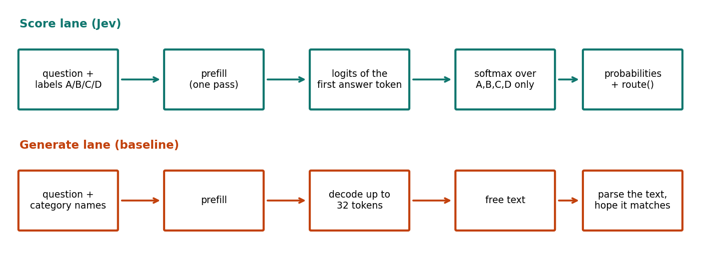
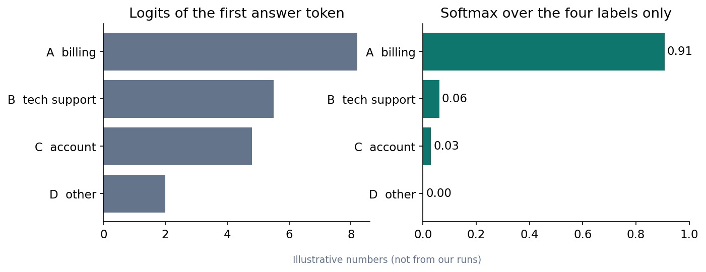

# Stop generating answers you could just score

> DRAFT. Every `[[RESULT: …]]` marker is a number that must come from `article/tables.md` after a real run (`python -m bench.full …`). No number in this post is borrowed from anyone else.

A lot of LLM calls in production never write anything new. They *choose*: route this ticket, accept or reject this expense, pick one of five labels. We still run them through chat generation, ask for JSON, and parse text. This post builds the alternative, **scoring a fixed set of answers from the logits of the first output token**, measures it against ordinary generation on the same server, and is honest about where it breaks.

Idea credit: a thread by Avi Chawla describing the technique. Everything below is re-implemented and re-measured here.

## 1. Choosing is not writing



*Figure 1. Same question, two lanes. The generate lane pays for decoding and then has to parse prose. The score lane stops after the forward pass.*

## 2. What the model actually computes

At the position where the answer starts, a model produces one logit per vocabulary token. If every allowed answer is a single token, we can read those few logits, apply a softmax over just them, and get a probability distribution over our options. No decoding loop, no JSON.



*Figure 2. Illustration with made-up logits, not a measurement.*

## 3. Why the options are `A`, `B`, `C`

A category like `billing_fees` is several tokens, and its first token may be shared with another category. A letter is one token, and we check it: `Jev._label_ids` tokenizes each label bare (no leading space, because the answer is the first token after the assistant turn) and refuses anything that is not exactly one token. The application never sees letters: `decide()` maps them back to `billing`, `card_issues`, and so on.

## 4. Implementation

The whole client is one file, `jev/decide.py`:

```python
def decide(self, task, text, choices):
    msg, labels = build_prompt(task, text, choices)
    prompt = self.tok.apply_chat_template(
        [{"role": "user", "content": msg}], tokenize=False, add_generation_prompt=True)
    ids = self._label_ids(labels)
    scores = self._scores(prompt, ids)          # one POST to /v1/score, softmax over `ids`
    probs = dict(zip(labels.values(), scores))
    return {"choice": max(probs, key=probs.get), "probabilities": probs}
```

Two design decisions matter more than the code:

- **An escape option (`other`) is mandatory.** A softmax over four options always sums to 1, so without `other` an off-topic message still gets a confident-looking distribution.
- **The policy lives in code, not in the model.** `route()` automates only when the winner clears a probability threshold *and* a margin over the runner-up, otherwise the item goes to a human.

## 5. Experiment

**Data.** Banking77 customer messages grouped into four teams (`card_issues`, `payments_transfers`, `billing_fees`, `account_access`), plus out-of-scope messages from CLINC150 as `other`. 250 dev and 125 test cases, balanced across the five classes, fixed seed. Dev is used to choose thresholds, test is used for every reported number. Sources: Banking77 (CC-BY-4.0), CLINC150 (CC-BY-3.0).

**Setup.** One SGLang server per model on `[[RESULT: GPU, driver, SGLang version from tables.md → Environment]]`. Models: `[[RESULT: list]]`. Both lanes use the same model, server and test cases. The generate lane names the categories (no letters), allows 32 new tokens and parses the first whole-word category mention in the first 100 characters. A matched one-token lane uses the identical A/B/C scoring prompt and generates only one token. Solo lane order is randomized and every case is primed before measurement; optional `--cold-cache` flushes the KV cache before each request and reports those measurements separately. A third lane uses constrained JSON decoding (`response_format` with a schema whose only field is an enum of the categories). The score lane is also run in batches of `[[RESULT: batch]]` messages per request. Each lane is run alone and then the score and generate lanes at the same time behind a barrier, `[[RESULT: reps]]` repetitions each, after a warm-up that is discarded.

Reproduce with one command: `python -m bench.full --models <model> ...`.

## 6. Results

### Latency and accuracy


[[RESULT: paste the "Latency and accuracy" table from article/tables.md and describe the gap in p50/p95 and requests per second, solo and concurrent. State plainly if the gap is small or if the generate lane is more accurate.]]

### Batching and constrained JSON

[[RESULT: paste the "Batched scoring" table and the structured rows of the latency table. Say whether batching raises requests per second and whether decisions change; say how structured decoding compares on latency and accuracy.]]

### The probability is not the accuracy

A top probability of 0.91 does not mean the answer is right 91% of the time. The reliability diagram compares stated confidence with actual accuracy on the test set:


[[RESULT: ECE before/after temperature scaling and what the curve shows.]]

### Option order changes the answer

The labels are positional, so the order of options can shift the result. We shuffled the order of options (including `other`) `[[RESULT: n]]` times:


[[RESULT: share of decisions that change, accuracy shuffled vs original, and whether averaging over orders helped. The cost of averaging is one extra request per order.]]

### Turning probabilities into an automation policy

Thresholds are picked on dev (largest share automated at ≥ `[[RESULT: target]]` accuracy) and reported on test.

[[RESULT: paste the "Automation policy" table. Compare the untuned 0.80/0.20 policy with the tuned ones.]]

### Does training help? (fine-tuned vs untouched)

The same 0.5B model, once as shipped and once fine-tuned with LoRA (`train/lora.py`) on `[[RESULT: n_train]]` labeled examples that share no text with dev or test. The loss is cross-entropy on the first answer token, i.e. exactly the position scored at inference, and the option order is reshuffled each epoch. `[[RESULT: from tables.md: accuracy, ECE, order-flip rate and automated share, untouched vs fine-tuned. State whether training fixed calibration and order bias or only raised accuracy. Training settings are in models/jev-*/train_log.json.]]`

## 7. Limits

- It needs a **closed** set of answers. Open-ended questions still need generation.
- Two domains (bank support and news) and `[[RESULT: n]]` test cases: differences of a few points are within noise.
- The logits are not calibrated out of the box. We corrected them with a single temperature fitted on dev. The only training we did is one small LoRA fine-tune (section above); we did not reproduce any larger training pipeline.
- Batching is measured on one prompt template with the shared prefix as the query; the server tokenizes query and item separately, so we also report how often a batched decision equals the one-by-one decision.

## 8. When to use which

Use scoring when the answer is one of N known options and you want a confidence you can threshold. Use generation when the answer is open-ended, or when you need the explanation, not only the decision.

---

## Appendix: the code for every figure

All figures are produced by `article/figures.py` (`python -m article.figures`). Figures 1 and 2 need no data; the rest read `bench/results/*.json`.

Figure 1 (flow): each lane is a row of boxes joined by arrows.

```python
def box(ax, x, y, w, h, text, color):
    ax.add_patch(FancyBboxPatch((x, y), w, h, boxstyle="round,pad=0.02", fc="white", ec=color, lw=2))
    ax.text(x + w / 2, y + h / 2, text, ha="center", va="center", fontsize=9)

def arrow(ax, x0, y0, x1, y1, color=GREY):
    ax.annotate("", (x1, y1), (x0, y0), arrowprops=dict(arrowstyle="->", color=color, lw=1.8))
```

Figure 2 (softmax illustration): left, raw logits; right, the same numbers after `exp(x - max) / sum`.

```python
logits = [8.2, 5.5, 4.8, 2.0]
e = [math.exp(x - max(logits)) for x in logits]
p = [v / sum(e) for v in e]
```

Figures 3–6 (latency, accuracy, reliability, order bias): bars show the mean over repetitions and whiskers show min..max, so run-to-run noise is visible. The reliability curve bins the top probability into ten bins and plots mean confidence against actual accuracy; ECE is the bin-size-weighted gap.
